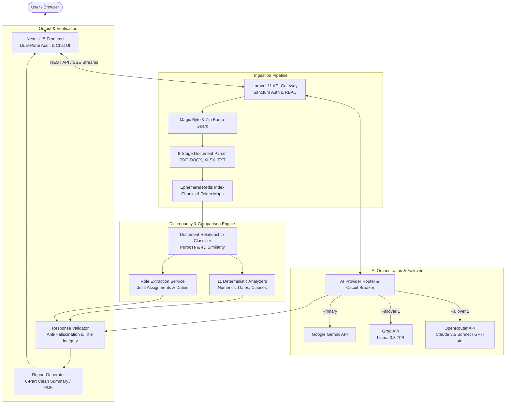

# DocVer — Enterprise AI Document Comparison & Verification SaaS

[](https://www.php.net/)
[](https://laravel.com/)
[](https://nextjs.org/)
[](https://www.typescriptlang.org/)
[-brightgreen?logo=phpunit&logoColor=white)](https://phpunit.de/)
[](https://tailwindcss.com/)
[]()

**DocVer** is a high-assurance, multi-provider AI document verification and comparison SaaS engineered for enterprise legal, compliance, procurement, and operations teams. It compares contracts, financial agreements, schedules, and specifications, detecting numerical, date, and clause discrepancies with deterministic accuracy and zero hallucinations.

---

## Table of Contents

- [Key Capabilities](#key-capabilities)
- [Architecture & Tech Stack](#architecture--tech-stack)
- [System Architecture Flowchart](#system-architecture-flowchart)
- [Multi-Provider AI Resilience](#multi-provider-ai-resilience)
- [Intelligent Comparison & Role Extraction Engine](#intelligent-comparison--role-extraction-engine)
- [Repository Structure](#repository-structure)
- [Getting Started](#getting-started)
  - [Prerequisites](#prerequisites)
  - [Backend Setup (Laravel 11)](#backend-setup-laravel-11)
  - [Frontend Setup (Next.js 15)](#frontend-setup-nextjs-15)
- [Running Tests & Benchmarks](#running-tests--benchmarks)
- [Documentation Index](#documentation-index)
- [Contributing & License](#contributing--license)

---

## Key Capabilities

- **Intelligent Document Purpose Classification:** Automatically identifies whether two documents are versions of the same draft, related topic documents, independent operational documents with different purposes (e.g. personal schedule vs team role allocation), or completely unrelated.
- **Multi-Dimensional Similarity Scoring:** Eliminates arbitrary risk-deducted percentages. Evaluates 4 distinct dimensions: Textual Overlap, Structural Heading Alignment, Topic Domain Match, and Semantic Similarity, backed by plain-language explanations.
- **Deterministic Role & Joint Assignment Extraction:** Extracts person names, preserves joint assignments (e.g. *Gideon Raj and Nihal*), distinguishes formal job titles from operational duties without hallucinating executive titles (such as *CTO*), and accurately reports member headcounts.
- **Three-Provider AI Orchestration:** Resilient multi-provider router with Google Gemini (Primary), Groq (Fast Fallback), and OpenRouter (Secondary Fallback), backed by circuit breakers, token quotas, and exponential backoff with jitter.
- **Deterministic Discrepancy Engine:** 11 specialized analyzers identifying added, removed, modified, unique provisions, numerical differences (`$10,000` vs `USD 10,000`), timeline changes, and direct legal contradictions.
- **Zero Permanent Content Storage:** Temporary raw document storage with hourly privacy purges, ephemeral Redis citation indexing, and zero permanent storage of document bodies in MySQL for strict data privacy.
- **AI Evaluation & Benchmark Suite:** 1,150 automated test cases across 10 evaluation categories, a CLI evaluation runner (`php artisan docver:evaluate-ai`), and an Admin Evaluation Dashboard.
- **Downloadable PDF Audit Reports:** Generates executive summaries, itemized difference tables, unique sections, and grounded citations via DomPDF.

---

## Architecture & Tech Stack

### Frontend
- **Framework:** [Next.js 15](https://nextjs.org/) (App Router, Server & Client Components)
- **Language:** TypeScript 5 (Strict Mode)
- **Styling & UI:** Tailwind CSS, Radix UI primitives, Lucide React, Framer Motion
- **State Management & Fetching:** Zustand, TanStack Query (React Query v5)
- **Document Viewing:** Dual-pane split-screen redline audit viewer, interactive citation highlights, floating AI chat drawer

### Backend
- **Framework:** [Laravel 11](https://laravel.com/)
- **Runtime:** PHP 8.3+ / PHP 8.4+
- **Authentication:** Laravel Sanctum (Stateful Cookie-based SPA & API Token authentication)
- **Database:** MySQL 8.0+ / PostgreSQL / SQLite (Testing)
- **Caching & Queues:** Redis, Laravel Horizon
- **Document Ingestion:** Spatie PDF to Text, PhpSpreadsheet, Smalot PDF Parser, Magic Byte Validator

---

## System Architecture Flowchart



---

## Multi-Provider AI Resilience

DocVer's AI subsystem never relies on a single provider:

```
Request ──> [ Gemini 2.0 Flash ] ──(Failure / Quota)──> [ Groq Llama 3.3 70B ] ──(Failure)──> [ OpenRouter Claude 3.5 Sonnet ]
                     │                                           │                                              │
                     └───────────────── Circuit Breakers, Retries & Quota Tracking ────────────────────────────┘
```

1. **Primary Provider (Google Gemini):** Default high-throughput, low-latency reasoning model.
2. **Fast Fallback (Groq API):** Ultra-fast Llama-3.3-70B inference triggered on Gemini 429 quota exhaustion or timeouts.
3. **Secondary Fallback (OpenRouter API):** Claude 3.5 Sonnet or GPT-4o for enterprise-grade contract synthesis when upstream networks fail.
4. **Circuit Breakers:** Automatically isolates failing providers after 3 consecutive errors and cools down for 60 seconds before probing health.

---

## Intelligent Comparison & Role Extraction Engine

When comparing documents with distinct operational purposes (e.g. a personal schedule vs team role assignments):
- **Classification:** Categorized as `different_purposes` rather than treated as draft revisions.
- **Finding Types:** Unique sections are flagged as `UNIQUE_A`, `UNIQUE_B`, or `NOT_COMPARABLE` rather than misclassified as "Modified" or "Missing" clauses.
- **Role Extraction:**
  - Questions like *"Who is taking the technical role in Document 2?"* immediately name assigned personnel (*Gideon Raj and Nihal*) and cite supporting text without generating unrequested legal audits.
  - Distinguishes descriptive operational responsibilities from official executive titles, preventing the hallucination of ungrounded titles like *CTO*.
  - Explicitly reports joint assignments and headcount.

---

## Repository Structure

```
DocVer/
├── app/                                 # Laravel Core Application
│   ├── Enums/                           # FindingType, ComparisonStatus, DocumentRole
│   ├── Http/Controllers/Api/V1/        # ChatController, ComparisonController, DocumentController
│   ├── Models/                          # ComparisonJob, DocumentMetadata, ChatMessage, User
│   └── Services/
│       ├── AI/                          # AIOrchestrator, AIRouter, PromptManager, ResponseValidator
│       ├── Comparison/                  # ComparisonOrchestrator, RoleExtractionService, ReportGenerator
│       └── Documents/                   # DocumentService, EphemeralIndexManager, IngestionPipeline
├── backend/                             # Mirrored production backend service
├── components/                          # Shared UI components
├── database/
│   ├── ai_evaluation/                   # 1,150 AI evaluation benchmark test cases & fixtures
│   ├── migrations/                      # Database migrations
│   └── seeders/                         # Database seeders
├── frontend/                            # Next.js 15 App Router Frontend
│   ├── src/
│   │   ├── app/                         # App Router Pages (dashboard, compare, admin/ai-evaluation)
│   │   ├── components/                  # UI components, sidebars, modals, audit viewer
│   │   ├── lib/                         # API client, csrf, utils
│   │   ├── services/                    # Frontend comparison & chat API services
│   │   └── stores/                      # Zustand state stores (comparison-store, auth-store)
│   ├── package.json
│   └── tsconfig.json
├── tests/
│   ├── Feature/                         # 188 PHPUnit Feature & Integration Tests
│   └── TestCase.php
├── .env.example                         # Environment configuration template
├── phpunit.xml                          # PHPUnit test configuration
└── README.md                            # Documentation entry point
```

---

## Getting Started

### Prerequisites

Ensure you have installed:
- **PHP** >= 8.3 (with `pdo`, `mbstring`, `tokenizer`, `xml`, `ctype`, `json`, `curl`, `redis`)
- **Composer** >= 2.6
- **Node.js** >= 18.18.0 & **npm** >= 9.x
- **MySQL** >= 8.0 (or PostgreSQL 14+)
- **Redis** >= 6.2

---

### Backend Setup (Laravel 11)

1. **Clone the repository:**
   ```bash
   git clone https://github.com/NihalCilamkoti/DocVer.git
   cd DocVer
   ```

2. **Install PHP dependencies:**
   ```bash
   composer install
   ```

3. **Configure Environment:**
   ```bash
   cp .env.example .env
   php artisan key:generate
   ```

4. **Update `.env` with your database and AI API credentials:**
   ```env
   DB_CONNECTION=mysql
   DB_HOST=127.0.0.1
   DB_PORT=3306
   DB_DATABASE=docver_db
   DB_USERNAME=root
   DB_PASSWORD=your_password

   REDIS_HOST=127.0.0.1
   REDIS_PORT=6379

   # AI Provider Keys
   GEMINI_API_KEY=your_gemini_key
   GROQ_API_KEY=your_groq_key
   OPENROUTER_API_KEY=your_openrouter_key
   ```

5. **Run migrations and seeders:**
   ```bash
   php artisan migrate --seed
   ```

6. **Start background queue worker:**
   ```bash
   php artisan queue:work redis --queue=default,high,low
   ```

7. **Start local development server:**
   ```bash
   php artisan serve --port=8000
   ```

---

### Frontend Setup (Next.js 15)

1. **Navigate to the frontend directory:**
   ```bash
   cd frontend
   ```

2. **Install Node dependencies:**
   ```bash
   npm install
   ```

3. **Configure Frontend Environment:**
   ```bash
   cp .env.example .env.local
   ```
   Ensure `NEXT_PUBLIC_API_URL=http://localhost:8000` is configured in `frontend/.env.local`.

4. **Run development server:**
   ```bash
   npm run dev
   ```

5. **Open in browser:**
   Navigate to [http://localhost:3000](http://localhost:3000).

---

## Running Tests & Benchmarks

DocVer includes an automated test and benchmark suite with a 100% pass rate.

### 1. PHPUnit Test Suite
Runs all 188 feature and unit test scenarios:
```bash
./vendor/bin/phpunit
```

Expected output:
```
OK (188 tests, 1264 assertions)
```

Targeted regression tests for intelligent comparison and role extraction:
```bash
./vendor/bin/phpunit tests/Feature/IntelligentDocumentComparisonAndRoleExtractionTest.php
```

### 2. AI Evaluation Benchmark Runner
Evaluate the multi-provider AI pipeline against 1,150 evaluation questions across 10 distinct categories (general conversation, spelling variations, document QA, summarization, comparison, structured extraction, multi-turn dialogue, hallucination prevention, failure modes, instruction following):
```bash
php artisan docver:evaluate-ai --category=all
```

Or view results interactively in the web dashboard at `/dashboard/admin/ai-evaluation`.

---

## Documentation Index

- [Installation Guide](INSTALLATION.md) — Step-by-step local and Docker installation.
- [Production Deployment Guide](DEPLOYMENT.md) — Nginx, SSL, systemd, Redis, and supervisor setup.
- [API Documentation](API_DOCUMENTATION.md) — Complete REST API reference, request payloads, and responses.
- [Security Audit & Protections](SECURITY.md) — Magic byte validation, ZIP bomb defenses, and prompt injection filters.
- [Privacy & Retention Guarantees](PRIVACY.md) — Zero permanent storage and hourly ephemeral purges.
- [AI Providers & Model Routing](AI_PROVIDERS.md) — Multi-provider failover, models, and circuit breaker mechanics.
- [Troubleshooting & Diagnostics](TROUBLESHOOTING.md) — Common error resolution and debug workflows.
- [Contributing Guide](CONTRIBUTING.md) — Code standards, pull request workflows, and branch conventions.

---

## Contributing & License

Contributions are welcome! Please review [CONTRIBUTING.md](CONTRIBUTING.md) before submitting pull requests.

Copyright © 2024–2026 DocVer. All rights reserved.
