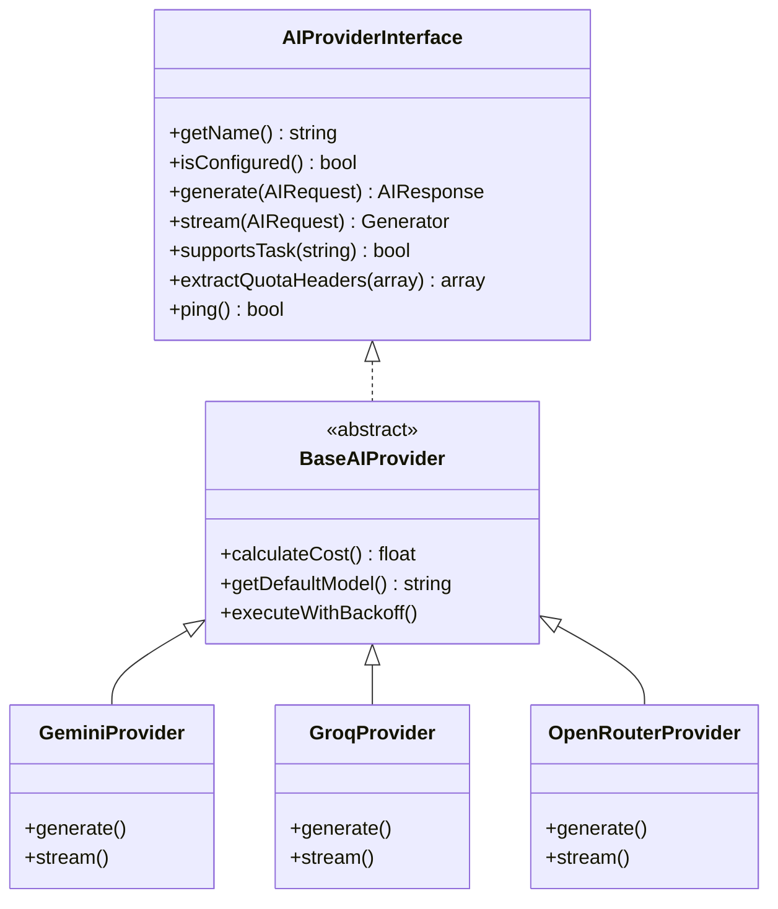

# AI Integration Architecture

DocVer integrates three enterprise AI providers through standardized adapters implementing `AIProviderInterface`:

1. **Google Gemini:** `GeminiProvider`
2. **Groq LPU:** `GroqProvider`
3. **OpenRouter:** `OpenRouterProvider`

## Smart Task Model Routing

Tasks are dispatched to optimal models:
- **Fast Text Extraction:** Groq (`llama-3.1-8b-instant`)
- **Deep Legal Comparison:** Google Gemini (`gemini-1.5-pro`) or OpenRouter (`anthropic/claude-3.5-sonnet`)
- **Contradiction Detection:** Gemini Pro / Claude 3.5 Sonnet
- **Interactive Verification Chat:** Groq / Gemini Flash
