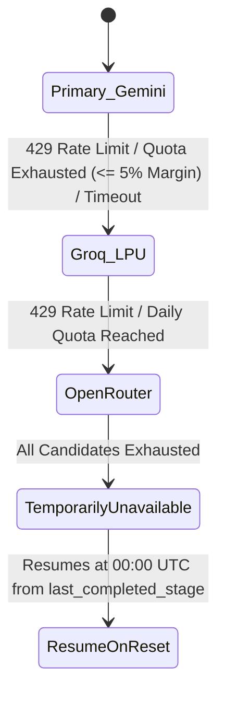

# Automatic AI Quota Failover & Job Preservation

## Failover Sequence

The orchestrator follows the deterministic chain:
$$\text{Google Gemini} \longrightarrow \text{Groq} \longrightarrow \text{OpenRouter}$$

## Proactive 5% Safety Margin

`AIQuotaManager` monitors daily requests and daily tokens. When allowance $\le 5\%$, the provider is preemptively bypassed before a hard HTTP 429 failure occurs.

## Job Preservation Guarantee

If all AI providers fail:
1. Comparison job is marked `status: 'temporarily_unavailable'`.
2. Intermediate chunks (`completed_chunks`) and stage (`last_completed_stage`) remain safely stored in MySQL.
3. Upon daily quota reset or manual retry, the job resumes from the exact uncompleted stage without re-processing earlier chunks.
