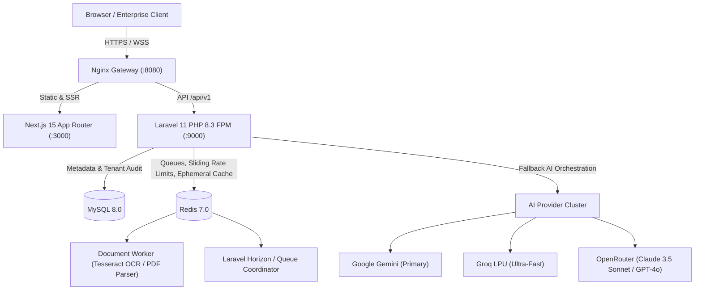

# DocVer System Architecture

DocVer is an enterprise-grade, privacy-first AI SaaS for legal and financial document verification and comparison.

## Modular Domain Boundaries

- **Frontend (`frontend/`):** Independent Next.js application utilizing React 19, TypeScript strict mode, Tailwind CSS, shadcn/ui, TanStack Query, and Zustand.
- **Backend (`backend/`):** Standard Laravel application structured around domain modules under `app/Modules/` and domain services under `app/Services/`.
- **Infrastructure (`infrastructure/`):** Docker, Nginx, MySQL, Redis, and health monitoring definitions.
- **Documentation (`documentation/`):** Complete specifications and operational guides.
