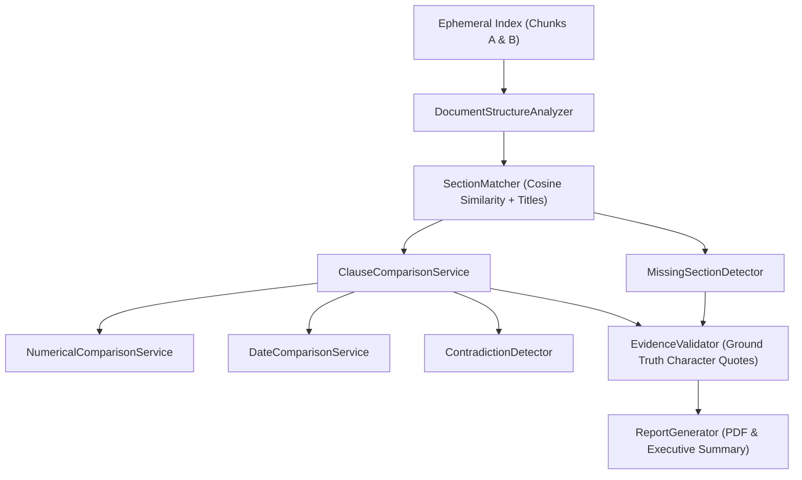

# Intelligent Comparison Engine

The core comparison engine evaluates two documents across multiple legal and financial dimensions without hallucinations.

## Deterministic Idempotency Keys

Every finding is assigned a unique idempotency key:
$$\text{id} = \text{hash}(\text{job\_id} + \text{type} + \text{title} + \text{pageA} + \text{pageB})$$
This ensures that retries and stage resumptions never introduce duplicate findings.
