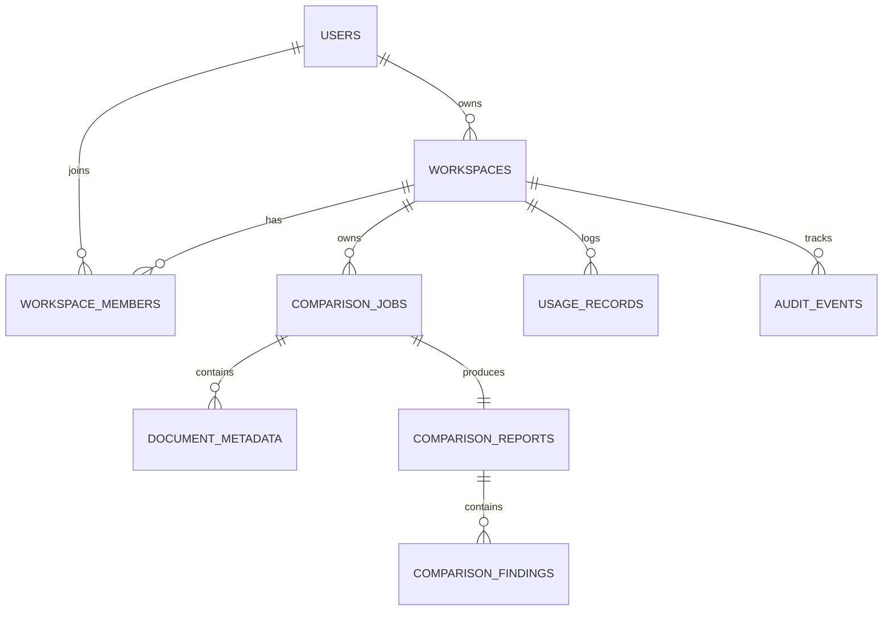

# Database Schema & Entity Relationships

DocVer uses MySQL 8.0 for persistent relational metadata.

## Entity Relationship Overview

## Migration Index

1. `users`: Authentication identities, roles (user, workspace_admin, super_admin).
2. `workspaces`: Tenant accounts, tier limits, settings.
3. `workspace_members`: Pivot table for multi-tenant workspace membership.
4. `document_metadata`: Temporary file metadata (hash, pages, size). Never stores document text!
5. `comparison_jobs`: Orchestration state, stage progress, similarity score, resume checkpoints.
6. `comparison_reports`: Executive summary, difference counts, export metadata.
7. `comparison_findings`: Verified findings with character quotes and page numbers.
8. `usage_records`: AI token audit logs and duration.
9. `provider_quotas`: Daily request and token counters, reset timestamps.
10. `provider_health`: Latency, circuit breaker states, and uptime logs.
11. `audit_events`: Security event log.
