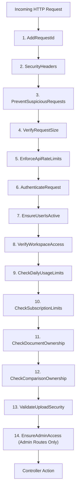

# Middleware Architecture & Execution Order

DocVer implements 14 independent, single-responsibility middleware classes under `app/Http/Middleware/`.

## Pipeline Execution Order

## Middleware Catalog

1. `AddRequestId`: Assigns unique UUID `X-Request-ID` to request and response headers.
2. `SecurityHeaders`: Injects HSTS, X-Frame-Options (DENY), CSP, and nosniff.
3. `PreventSuspiciousRequests`: Detects and blocks directory traversal and SQL injection probes.
4. `VerifyRequestSize`: Enforces max 50MB payload limits.
5. `EnforceApiRateLimits`: Sliding window rate limiter in Redis.
6. `AuthenticateRequest`: Enforces valid Sanctum tokens.
7. `EnsureUserIsActive`: Blocks deactivated accounts.
8. `VerifyWorkspaceAccess`: Prevents unauthorized cross-tenant operations.
9. `CheckDailyUsageLimits`: Tracks per-user daily token limits.
10. `CheckSubscriptionLimits`: Enforces workspace tier quotas.
11. `CheckDocumentOwnership`: IDOR prevention for documents.
12. `CheckComparisonOwnership`: IDOR prevention for comparison jobs.
13. `ValidateUploadSecurity`: Inspects binary signatures and magic bytes.
14. `EnsureAdminAccess`: Verifies super-administrator privileges.
