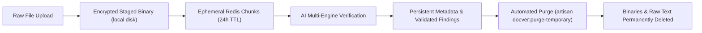

# Privacy & Data Retention Policy

## Zero Permanent Data Retention

DocVer enforces a strict Zero Permanent Retention policy:

1. **Original Binaries:** Stored temporarily with random UUID hashes. Deleted immediately after successful indexing or on job failure.
2. **Extracted Page Text:** Cached exclusively in Redis ephemeral chunks with a 24-hour TTL.
3. **Embeddings:** Never permanently persisted. Generated on-the-fly for candidate retrieval and cleared.
4. **Automated Purge Command:** `php artisan docver:purge-temporary --hours=24` scheduled daily to guarantee compliance.
